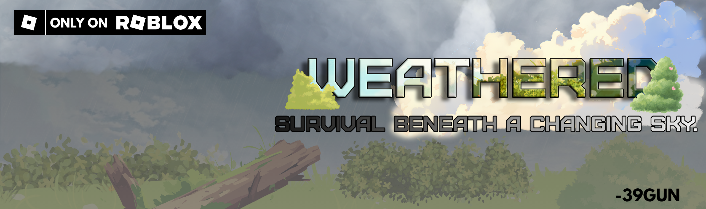
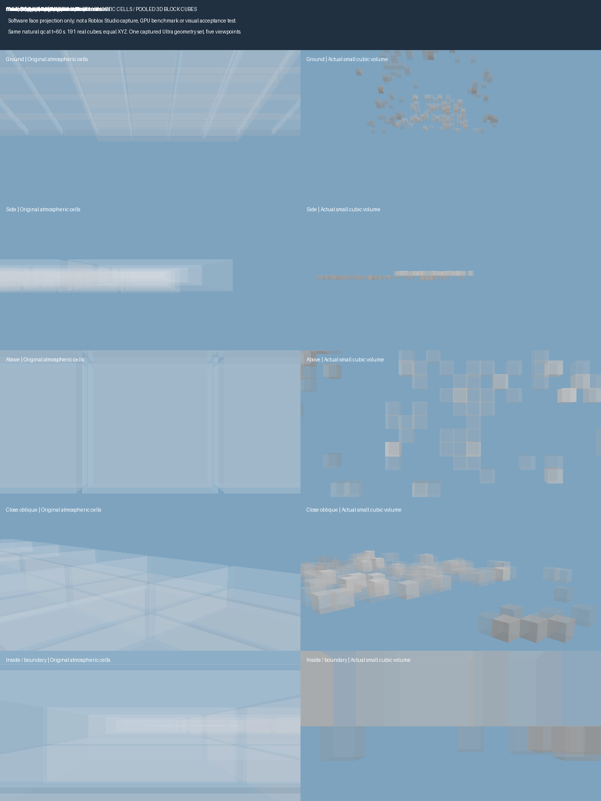
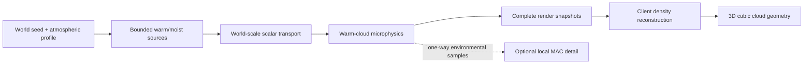

<p align="center">
  
</p>

<p align="center">
  <a href="https://create.roblox.com/"></a>
  
  
  
  <a href="LICENSE"></a>
  <a href="https://github.com/Loljosa/WEATHERED-TESTBRANCH/commits/main"></a>
</p>

<p align="center">
  <a href="#the-idea">The idea</a> ·
  <a href="#what-works-today">Current build</a> ·
  <a href="#quick-start">Quick start</a> ·
  <a href="#developer-controls">Controls</a> ·
  <a href="#how-it-works">Architecture</a> ·
  <a href="#validation--limitations">Validation</a> ·
  <a href="#documentation">Docs</a>
</p>

---

## The idea

**What if the weather wasn't just a skybox?**

WEATHERED is an experimental Roblox survival project built around an evolving, **server-authoritative atmosphere**. Instead of spawning pre-made cloud models, the engine models temperature, water vapor, liquid cloud water, and wind. Warm, moist regions can develop clouds through saturation and condensation; the resulting water is transported through a shared world field.

The weather engine is being developed independently of the larger survival game. **This repository is a research preview, not a finished storm simulator or a photorealistic cloud renderer.**

<table>
  <tr>
    <td align="center" width="25%"><strong>4,028 × 4,028</strong><br/><sub>studs of weather coverage</sub></td>
    <td align="center" width="25%"><strong>16</strong><br/><sub>logical world regions</sub></td>
    <td align="center" width="25%"><strong>0.25 s</strong><br/><sub>fixed physics timestep</sub></td>
    <td align="center" width="25%"><strong>2</strong><br/><sub>simulation quality presets</sub></td>
  </tr>
</table>

## What works today

<table>
<tr>
<td width="33%" valign="top">
  
  <h3>Cloud formation</h3>
  Deterministic world-seeded warm/moist sources; saturation adjustment, condensation, evaporation, and explicit source-input accounting.
</td>
<td width="33%" valign="top">
  
  <h3>Moving weather</h3>
  One conservative world-scale transport field. Clouds and moisture can cross internal region boundaries without resetting.
</td>
<td width="33%" valign="top">
  
  <h3>Actual 3D cloud cubes</h3>
  Phase 2.65 reconstructs cloud density into bounded, client-owned cubic <code>Block</code> Parts—not giant weather-grid tiles or flat billboards.
</td>
</tr>
</table>

**Current feature boundaries matter:** the global world uses a *prescribed divergence-free circulation*, not a full world-scale momentum solver. The buoyancy/pressure-projection MAC solver is retained as **optional local diagnostic detail** and is off by default. Phase 2.65's cubes are physically driven *visual proxies*, not volumetric light scattering.

### Cloud rendering: Phase 2.6 → 2.65

The previous preview exposed huge rectangular weather cells—about **125.875 studs wide on Laptop**. Phase 2.65 instead samples the complete liquid-water field and selects actual, smaller **12 / 16 / 24 / 48-stud cubic Parts** using pooled, density-aware geometry. That separates visual detail from the resolution of the atmospheric solver.

<details>
<summary><strong>See the before/after cubic-geometry study</strong></summary>



*This is a software-projected geometry comparison—not a Roblox Studio capture or a measured GPU/FPS result. The small blocks verify three-dimensional cubic geometry; their final visual quality, transparency sorting, and performance still require actual Studio testing.*

</details>

> **Latest milestone:** `0.2.65-alpha` implements density-driven cubic cloud volumes with Mobile, Balanced, High, and Ultra client quality budgets. **Studio visual acceptance and hardware FPS testing remain pending.**

---

## Quick start

**Requirements:** Git, Node.js/npm, [Rokit](https://github.com/rojo-rbx/rokit), and [Roblox Studio](https://create.roblox.com/). The pinned toolchain includes **Rojo 7.7.1** and **Lune 0.10.5**.

```bash
git clone https://github.com/Loljosa/WEATHERED-TESTBRANCH.git
cd WEATHERED-TESTBRANCH
rokit install
npm ci
mkdir -p build
rojo build default.project.json -o build/WEATHERED.rbxlx
```

Open `build/WEATHERED.rbxlx` in Studio and start **Play (F5)**, not server-only **Run**: the cubic cloud renderer runs on the **client**. This isolated atmospheric test place does not include a terrain floor or spawn setup. Use the camera to inspect the cloud layer; the [rendering guide](docs/phase2.65-cloud-rendering.md) provides its actual geometry/visual test procedure.

**Default world coordinates:** X and Z range from `-2014` to `+2014` studs. The preview cloud layer occupies **Y424–568 studs**. The chosen model conversion is **2 studs per physical meter**. This is a simulation convention, not an inherent Roblox unit definition.

<details>
<summary><strong>Live Rojo sync instead of a built place</strong></summary>

```bash
rojo serve default.project.json
```

Connect Studio's Rojo plugin to the CLI server. If using a Codespace, ensure the Rojo server port is forwarded and reachable. The VS Code Rojo extension is not required for the CLI workflow.

</details>

## Developer controls

### Weather simulation — server only

In Studio, select `ServerScriptService.Weather.WeatherServer`. In **Properties → Attributes**, enter commands into `WeatherCommand`; read the result in Output or `LastWeatherMessage`.

| Command | Purpose |
| :-- | :-- |
| `status` / `cloudmotion` | Simulation health, cloud displacement, velocities, dropped time |
| `weatherregions` / `worldsize 4028` | Inspect world coverage and all 16 logical regions |
| `wind 8 2` | Set physical X/Z wind in meters per second |
| `seed 84219` → `regenerate` | Choose a deterministic seed, then explicitly restart the world |
| `cloudcoverage scattered` → `regenerate` | Set a future Clear / Few / Scattered / Broken / Overcast scenario |
| `spawnseeded` | Queue a warm/moist source **without** resetting existing weather |
| `autoclouds on` / `autoclouds off` | Enable or pause future automatic source opportunities |
| `debugregions on` / `debugvectors on` | Show region lines and velocity vectors in applicable diagnostic modes |
| `speed 0.5` / `speed 1` | Change requested playback speed without changing physical step size |
| `pause` / `resume` / `seedstatus` / `help` | Timing, generation status and available commands |

Changing seed, initial coverage, or initial source count takes effect on explicit regeneration. `spawnseeded` preserves the active state and takes simulated time to build its source cache and condense water.

### Cloud rendering — local client

From the **client** Command Bar while playing:

```lua
local visuals = game.Players.LocalPlayer.PlayerScripts.Weather.WeatherClient.CloudVisualControls
visuals:Invoke("cloudrender cubes")
visuals:Invoke("cloudquality mobile")
visuals:Invoke("cloudrenderstats")
```

| Command | Effect |
| :-- | :-- |
| `cloudrender cubes` | Actual small 3D cubic cloud volumes (normal mode) |
| `cloudrender voxels` | Original coarse atmospheric grid (diagnostics) |
| `cloudrender hybriddebug` / `off` | Both visualizations / hide clouds |
| `cloudquality mobile` / `balanced` / `high` / `ultra` | Client render budgets; physics stays identical |
| `clouddebug density` / `gradients` / `bounds` / `off` | Inspect reconstructed visual-density properties |
| `cloudsnapshots` / `cloudrenderstats` | Replication and renderer statistics |

Touch devices start on **Mobile** graphics; other devices start on **Balanced**. Rendering quality never grants the client authority over weather conditions.

---

## How it works



**One physics world, many visual viewpoints.** The server transports potential temperature, vapor, cloud water, and rain-water state on a single coarse field. Sixteen logical regions partition coordinates and diagnostics; they do **not** own sixteen independent pressure solvers. The coarse world follows first-order upwind transport and warm-cloud saturation adjustment, with physical source and numerical-error ledgers.

Phase 2.65's separate **complete, versioned render snapshot** is used for cloud geometry. The older top-K sparse diagnostic snapshots cannot guarantee neighboring cell values for smooth reconstruction. On each client, bounded trilinear sampling, deterministic detail, interpolation, and capped cube pools turn the authoritative density into a visible volume.

| | Laptop (default) | Full |
| :-- | --: | --: |
| World coarse cells | `32 × 6 × 32` | `48 × 6 × 48` |
| Total world cells | 6,144 | 13,824 |
| Horizontal display cell spacing | 125.875 studs | ~83.917 studs |
| World regions | 4 × 4 | 4 × 4 |
| Vertical physical layer | 72 meters | 72 meters |
| Complete render snapshot | 8,576 bytes at 1 Hz | 19,136 bytes at 1 Hz |
| Client cube caps (Mobile / Balanced / High / Ultra) | 256 / 512 / 768 / 1280 | Same client quality tiers |
| Local MAC solver | Optional, off by default | Optional, off by default |

<details>
<summary><strong>Physics, rendering and numerical caveats</strong></summary>

- **Coarse circulation:** global winds are prescribed from a divergence-free construction. World-scale buoyancy-driven momentum is not yet resolved.
- **Limited altitude:** six vertical layers cover 72 physical meters. They cannot resolve deep cumulus towers or mature thunderstorms.
- **Cloud water:** source initialization supplies potential temperature and vapor—not visible `qc` directly. Condensation and evaporation evolve liquid cloud water.
- **Transport:** first-order upwind advection conserves transported inventories to numerical precision but diffuses small features.
- **Sources:** finite heat and water-input budgets prevent unlimited external forcing in the sealed/periodic experimental domain.
- **Rendering:** equal-axis `Block` Parts are genuine 3D geometry, not soft volumetric scattering. They may look faceted; transparency sorting and overdraw require Studio testing.
- **Boundary conditions:** default X/Z periodicity wraps at the **whole 4028-stud world boundary**, not at each region boundary. Vertical flux is sealed.
- **Local detail:** the optional MAC solver provides one-way diagnostic refinement; it does not feed liquid water back into the world field.

</details>

## Validation & limitations

The repository includes production-module Luau/Lune tests covering geometry, world transport, cross-region mass accounting, cloud generation, snapshots, rendering reconstruction, controls, and optional local detail.

```bash
npx stylua --check src scripts tests
lune run scripts/test-atmosphere.luau
lune run scripts/test-seeded-clouds.luau
lune run scripts/test-world-weather.luau
lune run scripts/test-cloud-rendering.luau
rojo build default.project.json -o build/WEATHERED.rbxlx
git diff --check
```

**Reported validation:** The Phase 2.65 release documentation records **498,026** focused production-module checks passing, including reconstruction, replication, cubic geometry, and resource bounds. Matched native-host world-step timings were about **21.17 vs. 21.34 ms** on Laptop between Phase 2.6 and 2.65 for the documented comparison, with byte-identical physical trajectories. These are *not* Roblox Studio FPS measurements.

**Still to validate in Studio:** real-time mobile and PC FPS, the appearance of cubic clouds from all angles, transparency/overdraw, render popping, multiplayer presentation, and interaction with the full survival game. [Test procedure and benchmark details →](docs/phase2.65-cloud-rendering.md)

### Roadmap

- [x] Phase 2.0 — Three-dimensional cloud dynamics and conservative transport.
- [x] Phase 2.5 — World-seeded, multi-source cloud formation.
- [x] Phase 2.6 — Transport across a **4028 × 4028-stud** weather world.
- [x] Phase 2.65 — Complete density snapshots and client-owned **3D cubic** cloud proxies.
- [ ] Phase 2.65 acceptance — Validate cloud appearance and real device performance in Studio.
- [ ] Phase 2.7 — Higher-fidelity cloud structure, detail, and display techniques.
- [ ] Phase 2.8 — More sophisticated cloud illumination and atmospheric rendering.
- [ ] Phase 3.x — Precipitation, terrain exchange, and deeper storm physics.

## Documentation

| Guide | Contents |
| :-- | :-- |
| [Phase 2.65 · Cloud rendering](docs/phase2.65-cloud-rendering.md) | Cubic geometry, complete snapshots, quality budgets, tests, known limits |
| [Phase 2.6 · World clouds](docs/phase2.6-world-clouds.md) | World coordinates, transport, regions, replication, performance |
| [Phase 2.5 · Seeded clouds](docs/phase2.5-cloud-generation.md) | Noise, heightmaps, source scheduling, forcing budgets |
| [Phase 2 · Dynamics](docs/phase2-dynamics.md) | MAC solver equations, pressure, advection and thermodynamics |
| [Cloud controls](docs/cloud-controls.md) | Earlier local control commands and preview settings |
| [Laptop performance](docs/laptop-performance.md) | Numerical cost, presets, performance troubleshooting |
| [README assets & credits](docs/readme-assets.md) | Lucide icons, existing logo and third-party licenses |
| [Contribution calendar notes](docs/readme-metrics.md) | Calendar attribution, provenance and optional updates |

<details>
<summary><strong>Repository structure</strong></summary>

```text
src/
├── shared/Atmosphere/
│   ├── Core/             Packed fields, grid, staggered velocities
│   ├── Dynamics/         Momentum, projection and transport
│   ├── Microphysics/     Condensation and evaporation
│   ├── Thermodynamics/   Sounding and saturation
│   ├── Generation/       Deterministic seeds, noise and sources
│   ├── World/            4028-stud coarse world model
│   └── Rendering/        Reconstructed density and render packets
├── server/Simulation/    World control, source forcing and replication
└── client/Rendering/    Local pooled cubic cloud visualization

docs/                     Technical notes and validation guides
scripts/                  Builds, tests, benchmarks and projections
tests/                    Production-module regression suites
assets/                   Project art, icons and README visuals
```

</details>

---

### Development activity

<p align="center">
  <a href="https://github.com/Loljosa"></a>
</p>

<sub>Calendar: <a href="https://github.com/Loljosa">Loljosa</a>'s GitHub account-wide activity, not a WEATHERED-only metric. Source and optional automation are described in <a href="docs/readme-metrics.md">calendar documentation</a>.</sub>

<p align="center">
  <strong>WEATHERED</strong> · Built in Luau for Roblox<br/>
  <a href="LICENSE">MIT License</a> ·
  <a href="https://github.com/Loljosa/WEATHERED-TESTBRANCH/issues">Issues</a> ·
  <a href="https://github.com/Loljosa/WEATHERED-TESTBRANCH/commits/main">Development history</a>
</p>
