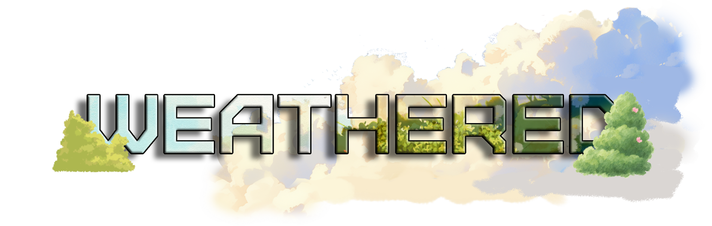
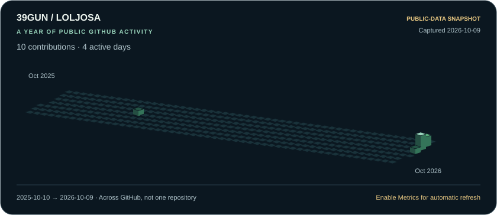

<p align="center">
  
</p>

<p align="center">
  <strong>Survival beneath a changing sky.</strong><br>
  A Roblox survival project with an atmosphere that evolves from the inside out.
</p>

<p align="center">
  
  
  
  <a href="https://github.com/Loljosa/WEATHERED-TESTBRANCH/commits/main"></a>
  <a href="LICENSE"></a>
</p>

<p align="center">
  <a href="#the-project"> Explore</a> &nbsp;·&nbsp;
  <a href="#launch-the-atmosphere"> Build &amp; run</a> &nbsp;·&nbsp;
  <a href="#take-control-of-the-sky"> Cloud controls</a> &nbsp;·&nbsp;
  <a href="#development-activity"> Activity</a> &nbsp;·&nbsp;
  <a href="#field-notes"> Documentation</a>
</p>

---

## The project

**WEATHERED** is being built around a simple idea: weather should shape the world
you survive in. Wind, visibility, vegetation and future storms will share one
server-authoritative atmospheric field.

This repository develops the weather engine independently of the larger game.
The **CM1-inspired warm-cloud prototype** runs natively in Luau. Phase 2.6 extends
cloud formation and transport across **4028 × 4028 studs**, organized into sixteen
logical regions. One shared world field carries vapor, liquid water and temperature
across region boundaries. Seeded warm/moist sources form liquid through saturation
and condensation; new sources join without resetting existing weather.

The coarse world uses a prescribed divergence-free circulation. The existing
buoyancy-driven MAC solver remains available as optional local detail. Its
one-way diagnostic coupling is off by default. Phase 2.65 reconstructs the liquid field into bounded, client-owned small cubes.
Complete quantized snapshots preserve neighboring cells; deterministic detail
never changes the atmosphere. Each normal cloud element is a real `PartType.Block` with equal X/Y/Z size.
Giant atmospheric cell Parts remain an explicit voxel debug mode. **Roblox Studio visual and device acceptance is still pending.**

<table>
<tr>
<td width="33%" valign="top">

<h3>Dynamic clouds</h3>
Seeded warm/moist air condenses and evaporates. Cloud water starts at zero.
</td>
<td width="33%" valign="top">

<h3>A moving atmosphere</h3>
Shared finite-volume transport carries clouds across the world and its sixteen regions.
</td>
<td width="33%" valign="top">

<h3>A practical preview</h3>
Packed buffers, reusable storage and a Laptop preset keep the prototype focused.
</td>
</tr>
</table>

<p align="center">
  
  
  
  
</p>

### From clear air to a cloud

<table>
<thead><tr><th>Stage</th><th>What evolves</th></tr></thead>
<tbody>
<tr>
<td> <strong>1 · Warm + moist</strong></td>
<td>Initialize potential temperature and vapor. Cloud water starts at zero.</td>
</tr>
<tr>
<td> <strong>2 · Rise + move</strong></td>
<td>Coarse circulation and 3D transport lift and carry air; optional local detail resolves buoyancy.</td>
</tr>
<tr>
<td> <strong>3 · Reach saturation</strong></td>
<td>Vapor converts into cloud water, accounting for latent heat.</td>
</tr>
<tr>
<td> <strong>4 · Show the field</strong></td>
<td>Small 3D cubes express reconstructed qc; optional voxels expose the numerical grid.</td>
</tr>
</tbody>
</table>

**The field drives the visuals.** Future gameplay will sample atmospheric state
for wind, rain and visibility. Cloud Parts are a debug renderer, not gameplay
collision objects.

| Where the project stands | Current scope |
| --- | --- |
| **Implemented** | World-scale conservative transport, seeded sources, bounded events, natural condensation and optional local MAC detail |
| **Available in Studio** | Coverage scenarios, regional/motion diagnostics, seed/regeneration, source injection, live wind and playback |
| **Verified by CLI** | Production-module Lune tests and Rojo builds |
| **Next** | Studio visual/device validation, deeper atmospheric dynamics and improved optical shading |

## Launch the atmosphere

You need Git, Node.js/npm, [Rokit](https://github.com/rojo-rbx/rokit) and Roblox
Studio. The toolchain pins **Rojo 7.7.1** and **Lune 0.10.5**. Use the Rojo CLI;
the VS Code Rojo extension is unnecessary.

<details>
<summary><strong>Starting with a new checkout?</strong></summary>

```bash
git clone https://github.com/Loljosa/WEATHERED-TESTBRANCH.git
cd WEATHERED-TESTBRANCH
```

</details>

From your repository terminal:

```bash
rokit install
npm ci
mkdir -p build
rojo build default.project.json -o build/WEATHERED.rbxlx
```

Open the built place in Studio and choose **Play (F5)**. Cubic clouds
run on the client, so server-only **Run** advances the atmosphere without showing
this renderer. This isolated place has no terrain, floor or spawn; use Studio's
camera to inspect the cloud layer.

1. Open **Output**. Keep `PerformancePreset=Laptop` and
   `WorldWeatherEnabled=true`. The server owns one 32×6×32 field and prints
   diagnostics every ten wall seconds.
2. Clouds cover X/Z **−2014…+2014** at **Y424–568**. Inspect the client folder
   `Workspace.WEATHERED_CUBIC_CLOUDS`. Sources are distributed across the map
   rather than centered at zero. Use the client visual controls below for voxels.
3. Switch to the **server** view for controls. Try `wind 8 2`, `debugregions on`
   and `debugvectors on`. Let at least two simulated minutes advance and compare
   `cloudmotion` and `weatherregions`; dropped time can make wall time longer.

The tested seed-84219 Scattered scenario with 8/2 m/s wind first displayed liquid
at **18 simulated seconds**. Other winds, seeds and coverage settings can differ.
Cubic rendering receives the complete coarse liquid field at 1 Hz. Its bounded
cube pool adds display detail; the physical cloud layer remains only 72 m deep.
The separate diagnostic stream still contains a bounded subset of liquid cells.

<details>
<summary><strong>Keep the camera above the clouds in the isolated Play test</strong></summary>

This place has no floor, so its character/camera can fall. In Studio's **client**
Command Bar, place the camera above the cloud layer:

```lua
local camera = workspace.CurrentCamera
camera.CameraType = Enum.CameraType.Scriptable
camera.CFrame = CFrame.lookAt(Vector3.new(0, 1400, 1800), Vector3.new(0, 480, 0))
```

This changes only the viewing camera. To restore the normal camera, run
`workspace.CurrentCamera.CameraType = Enum.CameraType.Custom` in that same client
Command Bar. Use the **server** view for weather commands.

</details>

<details>
<summary><strong>Prefer live sync?</strong></summary>

```bash
rojo serve default.project.json
```

Connect the [Studio Rojo plugin](https://rojo.space/docs/v7/getting-started/installation/)
to the CLI server. Studio must be able to reach the forwarded Rojo port when the
server runs in a Codespace. The Studio plugin is only needed for live sync;
building and opening a place works without it.

</details>

## Take control of the sky

During the test, select `ServerScriptService.Weather.WeatherServer`. In
**Properties → Attributes**, enter one command in **WeatherCommand** and press
Enter. The attribute clears after each command; **LastWeatherMessage** and
Output show the response.

| Try this | Result |
| --- | --- |
| `worldsize 4028` / `weatherregions` | Validate the full domain and inspect all sixteen regions |
| `cloudmotion` / `status` | Inspect field displacement, velocities, source inputs and dropped time |
| `seed 84219` → `regenerate` | Select a deterministic seed, then intentionally rebuild the world |
| `cloudcoverage few` → `regenerate` | Select Clear/Few/Scattered/Broken/Overcast initial conditions |
| `cloudcount 4` → `regenerate` | Choose 0–16 initial sources for the next initialization |
| `spawnseeded` | Queue another atmospheric source while existing clouds and time continue |
| `autoclouds on` / `autoclouds off` | Toggle new scheduled events without deleting current liquid |
| `seedstatus` | Inspect active/next seed settings, queue and remaining source budgets |
| `wind 8 2` / `wind -8 -2` | Change physical X/Z background wind in m/s |
| `debugregions on` / `debugvectors on` | Show boundaries; wind vectors appear in local Voxels/HybridDebug mode |
| `speed 0.5` / `speed 1` | Reduce requested work or return to normal playback |
| `pause` / `resume` | Preserve the timeline while paused, then continue |
| `form 60` / `reset` / `help` | Queue bounded evolution, intentionally regenerate, or list commands |
| `detail on` / `detail off` | Enable/disable one expensive local MAC diagnostic; default is off |
| `spawn Wide Fast` / `size 1.25` / `condensation Fast` | Start an isolated historical local experiment; global weather stays intact |

**`spawnseeded` retains the running world.** Its cache builds in bounded slices,
then supplies warm/moist forcing; it does not instantly create visible `qc`.
`regenerate` and `reset` intentionally restart the world. Coverage, seed and
initial source count apply only after that explicit reset. Source shape describes
atmospheric forcing; microphysics determines the resulting liquid water.

A moving-world preview: **`seed 84219` → `regenerate` → `wind 8 2` →
`debugregions on` → `spawnseeded`**. Faster playback requests more CPU work and
cannot guarantee faster wall-clock results. Use `speed 0.5` on struggling hardware
and leave local detail off. The [Phase 2.6 guide](docs/phase2.6-world-clouds.md)
explains every command and the exact multiplayer Studio test. With
`WorldWeatherEnabled=false`, the retained Phase 2.5 bootstrap and local pooled
renderer are available for comparison.

### Local cloud graphics

In **Play → Client**, select your `PlayerScripts.Weather.WeatherClient` script.
Set **CloudRenderCommand** in Attributes, or use the client Command Bar:

```lua
local visuals = game.Players.LocalPlayer.PlayerScripts.Weather.WeatherClient.CloudVisualControls
visuals:Invoke("cloudquality mobile")
visuals:Invoke("cloudrender cubes")
visuals:Invoke("cloudrenderstats")
```

| Local command | Result |
| --- | --- |
| `cloudrender cubes` / `voxels` / `hybriddebug` / `off` | Select small cubic volume cells, coarse numerical cells, both, or no graphics |
| `cloudquality mobile` / `balanced` / `high` / `ultra` | Change capped client resources; server physics stays unchanged |
| `clouddebug density` / `gradients` / `bounds` / `off` | Color cubes by reconstructed density, gradient or local height |
| `cloudsnapshots` / `cloudrenderstats` | Inspect completeness, packet size, stale data, resource counts and CPU work |

The default is **Cubes**, with Mobile on touch devices and Balanced otherwise.
`cloudrender smooth` remains a compatibility alias for the cubic renderer.
Normal graphics use only pooled three-dimensional Block Parts: no billboards,
image cards, emitters or texture dependency. Sparse adaptive XYZ subdivisions
sample the reconstructed liquid field. Smaller, denser lower cubes blend into
larger upper elements within the real physical layer, with distance culling and
strict creation/resource limits.
Read the [Phase 2.65 rendering guide](docs/phase2.65-cloud-rendering.md) for geometry
configuration, measured budgets, limitations and the required multi-angle Studio checklist.

## Inside the model

The world uses packed float64 fields and reusable transport/source buffers.
The retained local MAC solver uses float32. Both keep a fixed physical
**0.25-second timestep**; rendering and snapshots update less often.

<details>
<summary> <strong>Presets, world coverage and physical units</strong></summary>

| Setting | Laptop · default | Full · optional |
| --- | ---: | ---: |
| World coarse grid, X × Y × Z | 32 × 6 × 32 | 48 × 6 × 48 |
| World cells | 6,144 | 13,824 |
| Physical spacing, X/Y/Z | 62.9375/12/62.9375 m | 41.9583…/12/41.9583… m |
| World coverage, X/Z | 4028/4028 studs | 4028/4028 studs |
| Logical regions | 4 × 4, each 1007 × 1007 studs | Same |
| Initial Scattered sources / maximum | 6 / 16 | 8 / 16 |
| Source build samples per step | 128 | 192 |
| Complete render data / packet bytes | 1 Hz / 8,576 | 1 Hz / 19,136 |
| Diagnostic rate / voxel cap | 1 Hz / 256 | 2 Hz / 512 |
| Maximum steps per Heartbeat | 1 | 2 |
| Optional local MAC grid | 16 × 12 × 16 | 24 × 12 × 24 |

Keep Laptop for slower hardware. Change `PerformancePreset` while stopped, then
restart. The catch-up budget is a soft **8 ms**; an individual step may exceed it.
Excess backlog becomes reported dropped simulation time rather than an unlimited
catch-up loop. Optional local detail has a separate soft budget and remains off.

A single conversion, **2 studs per physical meter**, applies to X/Y/Z. The world
is 2014 physical meters wide/deep. Physical altitude 1000–1072 m maps to
**Y424–568 studs**, or 354–498 studs above terrain at Y70. World cubes represent
coarse volumes: roughly **126/84 studs wide** for Laptop/Full, and 24 studs tall.
The old 12-stud cubes belong to the retained local-only mode.

Wind axes are **u=X, v=Z, w=Y**, in m/s. At 8 m/s, air travels 16 studs per
simulated second. Internal regions have no walls or independent wrapping; default
periodicity is across the full world. `Workspace.WorldSeed` supplies the canonical
integer terrain seed when available, with fallback 84219. XZ/XY/YZ maps and
coherent 3D noise shape subsaturated warm/moist targets. Default Scattered humidity
is 99.5% in the shallow elevated cloud layer, rather than at the surface.

</details>

<details>
<summary><strong>Numerical architecture and current limits</strong></summary>

| Component | Authoritative world | Optional local detail |
| --- | --- | --- |
| Storage | Packed float64 SoA | Existing float32 SoA/MAC faces |
| Flow | Prescribed discrete divergence-free circulation, background wind and shear | Buoyancy, drag, diffusion and pressure projection |
| Scalars | First-order conservative upwind flux divergence with CFL substeps | Existing bounded conservative flux correction |
| Thermodynamics | Hydrostatic absolute pressure, potential temperature and production warm-cloud adjustment | Existing sounding, microphysics and latent heating |
| Boundaries | Full-world periodic X/Z by default; sealed Y; validated sealed lateral option | Periodic lateral shadow, conditioned boundary ring |
| Sources | World-seeded multi-axis geometry, fixed-tick events and explicit heat/water budgets | One-way environmental sampling; no global liquid feedback |
| Display | Low-rate shared snapshots and capped client pools | Retained local diagnostic experiment |

Water accounting assumes constant reference density. Reports are **unweighted
mixing-ratio sums**, not kilograms. External inputs and internal/outer-seam fluxes
are separate from numerical error. Sources never paint cloud water. First-order
world transport diffuses small features, and the shallow cloud layer does not
represent deep convection. The coarse circulation does not solve momentum or
pressure projection; the optional local solver does. Its slower diagnostic clock
and boundary relaxation are not synchronized two-way nesting.

Complete render snapshots support bounded density/velocity reconstruction and
soft visual transitions; sparse diagnostic summaries are excluded from it. Numerical fluxes
and displacement tests establish transport. Sparse caps can omit liquid cells
from the view without removing their atmospheric water. Precipitation fallout,
open boundaries, terrain feedback and balanced long-term water/energy exchange
remain future work. Equations and approximations are in the
[Phase 2.6 guide](docs/phase2.6-world-clouds.md).

</details>

## Validate a change

```bash
npx stylua src
npx stylua --check src scripts tests
lune run scripts/test-world-weather.luau
lune run scripts/test-atmosphere.luau
lune run scripts/test-seeded-clouds.luau
lune run scripts/test-cloud-rendering.luau
rojo build default.project.json -o build/WEATHERED.rbxlx
git diff --check
```

The full Phase 2.6 suite passed **177,714 production-module checks**, including
world geometry, deterministic sources, cross-region conservation, real liquid
formation, motion, coupling isolation, snapshot consistency, server bootstrap
and controls. `--quick` shortens long integration scenarios. The existing Phase 2
and 2.5 full suite also passed **8,240,846 checks**, loading the retained local
production modules in their historical scenarios.
Reports include source/test fingerprints so results can be tied to tested code.

The corrected Phase 2.65 suite passes **498,026 checks** against production
reconstruction, replication and cubic rendering modules. Normal elements are
equal-axis **12/16/24/48-stud Block Parts**, with active cube caps of
**256/512/768/1280** for Mobile/Balanced/High/Ultra. There is no cloud texture,
billboard, image or emitter dependency. Source budgets and physical buffers stay
unchanged by rendering.

The matched Phase 2.6/2.65 native comparison measured **21.170/21.344 ms** Laptop
and **46.351/45.535 ms** Full mean numerical step costs, with byte-identical
trajectories. Client scheduled updates averaged roughly **2.0–2.2 ms** Mobile
and **5.1 ms** Ultra on this host; occasional longer pauses remain in the report.
These are native timings, not Studio FPS. The complete current measurements and
five-view actual cubic-mesh projection procedure are in the
[Phase 2.65 guide](docs/phase2.65-cloud-rendering.md).

In the 240-second Laptop world test, liquid first appeared at 18 seconds, 986 cells
contained above-threshold liquid at the end, and the maximum source-corrected
water drift was **2.07×10⁻¹⁴** as a fraction. A manufactured 8/2 m/s transport test
measured **1873.27/467.90 meters** of X/Z travel over 240 seconds. Natural cloud
centroids also moved, but formation and evaporation affect those centroids.

A quiet 60-second native-host comparison measured world steps at **15.705 ms
mean / 22.373 ms p95** for Laptop and **38.854 / 53.773 ms** for Full. The frozen
Phase 2.5 local architecture measured 30.245/72.179 ms means. These are different
physical domains and solver responsibilities, not an isolated solver speedup.
World/source packed storage is **1.606 / 3.607 MB**, excluding rendering overhead.

Both world means exceed the soft 8 ms catch-up budget, and observed steps can
hitch. Initial source setup is synchronous; optional local MAC detail also exceeded
its soft budget in every measured step and remains off. **Studio FPS and
multiplayer presentation still require manual testing.** Rojo build, formatting
and whitespace checks passed. See the
[validation records](docs/phase2.6-world-clouds.md#validation-records) and
[performance measurements](docs/phase2.6-world-clouds.md#performance-measurements)
for complete results and remaining Studio checks.

## Field notes

| Guide | What you will find |
| --- | --- |
| [Phase 2.65 cloud rendering](docs/phase2.65-cloud-rendering.md) | Complete density data, continuous reconstruction, small 3D cubes, quality budgets and required visual tests |
| [Phase 2.6 world clouds](docs/phase2.6-world-clouds.md) | Full-world geometry, transport, coupling, replication, diagnostics and exact Studio procedure |
| [Phase 2.5 cloud generation](docs/phase2.5-cloud-generation.md) | Retained local seeded geometry, bounded events and historical measurements |
| [Cloud controls](docs/cloud-controls.md) | Legacy primitive shapes, live wind and earlier moving-cloud measurements |
| [Laptop performance](docs/laptop-performance.md) | Presets, work limits, profiling and Studio settings |
| [Phase 2 dynamics](docs/phase2-dynamics.md) | Equations, boundaries, units, conservation and solver diagnostics |
| [Phase 1 reference](docs/dynamic-cloud.md) | The earlier vertical-only warm-cloud prototype |
| [Activity calendar setup](docs/readme-metrics.md) | Snapshot provenance and optional lowlighter/metrics automation |
| [Visual assets](docs/readme-assets.md) | Official Lucide icons, premade badges and third-party licenses |

<details>
<summary> <strong>Repository map</strong></summary>

```text
assets/                   Branding and README visuals
src/
├── shared/Atmosphere/
│   ├── Core/             Geometry, staggered faces and packed state
│   ├── Thermodynamics/   Sounding, temperature conversion and saturation
│   ├── Microphysics/     Warm-cloud phase conversion
│   ├── Dynamics/         Momentum, projection and 3D transport
│   ├── Generation/       World seeds, heightmaps, noise and source descriptions
│   ├── Rendering/        Complete render data, continuous density, local detail and lighting
│   ├── World/            Coordinates, coarse field, sources, snapshots and client debug
│   ├── Utilities/        State validation
│   ├── Simulation.lua    Simulation ownership and stepping
│   └── init.lua          Public atmosphere entry point
├── server/
│   ├── Simulation/       World/local controllers, coupling, replication and controls
│   ├── Debug/            Pooled voxel visualization
│   └── WeatherServer.server.lua
└── client/
    ├── Rendering/        Capped local cubic volume renderer and resource pool
    ├── WorldWeatherClient.lua
    └── WeatherClient.client.lua

docs/                     Physics notes and Studio instructions
scripts/                  CLI tests and benchmarks
tests/                    Production-module tests and Roblox lookup adapters
.github/workflows/        Optional activity-calendar refresh
```

</details>

## The next horizon

- [x] Establish a clear-air warm-cloud model with natural condensation.
- [x] Add conservative 3D transport and validated pressure projection.
- [x] Add moving-cloud controls and a smaller Laptop preview.
- [ ] Profile in Studio and improve transport/solver cost.
- [x] Add world-seeded multi-source geometry and bounded ongoing formation.
- [x] Transport naturally condensed cloud water across a 4028 × 4028-stud world.
- [ ] Improve world transport accuracy and conservative local nesting.
- [ ] Balance surface/precipitation water and energy exchange.
- [ ] Expose sampling services for existing survival gameplay systems.
- [ ] Add precipitation, terrain interaction and storm lifecycle.
- [x] Implement field-driven client cloud reconstruction, pooled cubic volumes and LOD.
- [ ] Validate cubic cloud appearance, transparency and device FPS in Studio.

Core modules stay `--!strict`, with documented units, packed fields and reusable
storage. Changes should preserve working inventory, crafting, movement and world
systems while keeping simulation and rendering independent.

## Development activity

<p align="center">
  <a href="https://github.com/Loljosa"></a>
</p>

**39GUN · GitHub account: [Loljosa](https://github.com/Loljosa).** This calendar
covers account-wide GitHub contributions, not only WEATHERED commits.
The image is rendered by the official
[lowlighter/metrics Isocalendar plugin](https://github.com/lowlighter/metrics/tree/master/source/plugins/isocalendar)
using recorded GitHub contribution data. The included full-year snapshot is
reproducible offline. Enable daily updates with the `METRICS_TOKEN` repository
secret and **Actions → README contribution calendar → Run workflow**.
[Calendar data, reproduction and setup](docs/readme-metrics.md).

---

<p align="center">
  <strong>WEATHERED</strong> · Made for Roblox · Built in Luau<br>
  <a href="LICENSE">MIT License</a> ·
  <a href="docs/readme-assets.md">Lucide icon credits</a> ·
  <a href="https://github.com/Loljosa/WEATHERED-TESTBRANCH/issues">Issues &amp; feedback</a> ·
  <a href="https://github.com/Loljosa/WEATHERED-TESTBRANCH/commits/main">Development history</a>
</p>
