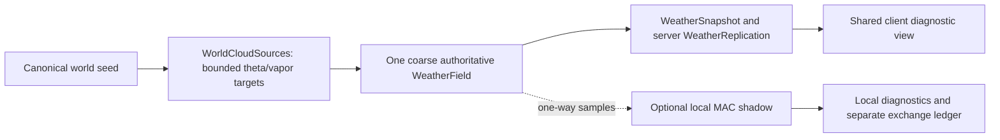

# Phase 2.6: world-scale atmospheric cloud transport

Phase 2.6 makes one server-owned atmospheric field span exactly **4028 × 4028
Roblox studs**. Sixteen logical regions organize diagnostics and future streaming;
they do not own independent physics boxes. A liquid cloud can cross their shared
edges through the same finite-volume faces used everywhere else in the field.

The world model and the existing local MAC model have different responsibilities.
The world model transports vapor, liquid water and potential temperature on a
bounded coarse grid, with prescribed divergence-free wind and real warm-cloud
saturation adjustment. The local model retains momentum, buoyancy, MAC pressure
projection and the existing higher-order conservative transport. Optional local
detail is a one-way diagnostic refinement. It does not add a second copy of its
liquid water back into the authoritative world inventory.

This phase adds diagnostic client cubes and vectors, not a final cloud renderer.
It does not introduce particles, volumetric rendering, terrain generation or
gameplay changes. The legacy local solver and its developer tools remain usable.

## Ownership and module boundaries



There is no local-to-world liquid feedback in this phase. Logical regions are
coordinate/diagnostic partitions of `WeatherField`, rather than sixteen models.
Replication reads the world; it does not allocate atmospheric state per player.

| Module | Responsibility |
| --- | --- |
| `shared/Atmosphere/World/WorldCoordinates.lua` | Immutable physical/display geometry and sixteen-region lookup |
| `World/WeatherField.lua` | Packed coarse state, circulation, microphysics, atomic stepping and diagnostics |
| `World/FieldAdvection.lua` | Reusable conservative face fluxes, positivity/CFL checks and substeps |
| `World/Coverage.lua`, `World/WorldCloudSources.lua` | Thermodynamic scenarios, seeded geometry and bounded fixed-tick forcing |
| `World/WeatherSnapshot.lua` | Validated packed sparse snapshot codec and read-only interpolation |
| `World/WorldVoxelDebugRenderer.lua` | Capped client cube/vector/region pools |
| `server/Simulation/WorldWeatherController.lua` | Fixed-step accumulator, catch-up limits, timeline and world ownership |
| `WorldWeatherControls.lua`, `WorldWeatherBootstrap.lua` | Server-only commands, startup attributes and lifecycle/failure handling |
| `AtmosphericCoupling.lua` | At most one optional existing MAC solver and separate one-way exchange ledger |
| `WeatherReplication.lua`, `client/WorldWeatherClient.lua` | Bounded shared publication, late joins and client interpolation |

`WeatherServer.server.lua` selects the world bootstrap before its preserved local
implementation. `WeatherClient.client.lua` starts the diagnostic subscriber.
`WeatherServer.meta.json` enables the Laptop world defaults. Existing local
`Simulation.lua`, pressure projection, conservative transport, warm-cloud physics
and Phase 2.5 generation modules retain their implementations.

## World geometry and units

`World/WorldCoordinates.lua` owns the conversion between physical meters and
Roblox studs. The default scale is **2 studs per meter** in every direction.
It is a modeling choice; Roblox does not intrinsically identify either unit.
The scale is validated and immutable after world construction. Reinitialization
is required to change it.

With physical altitude `a`, world altitude `Y`, base altitude `a0`, display base
`Y0`, and scale `s`:

```text
X_studs = s*x_meters
Z_studs = s*z_meters
Y_studs = Y0 + s*(a_meters-a0)

x_meters = X_studs/s
z_meters = Z_studs/s
a_meters = a0 + (Y_studs-Y0)/s
```

The default domain is X/Z `[-2014,+2014)` studs, centered on zero. Bounds are
half-open so every interior position belongs to exactly one region and cell.
The upper edge belongs outside the finite coordinate lookup; explicit periodic
wrapping maps it to the lower outer edge. Width and depth are each **4028**, not
4028-radius regions. Changing the center translates both bounds without changing
the size. Unsupported horizontal sizes are rejected.

The vertical interval is deliberately independent of the horizontal world size:
physical altitude 1000–1072 meters maps to Y424–568 studs. The coarse cloud layer
is 72 physical meters deep. This shallow prototype layer preserves the requested
game-world cloud height with one consistent scale. It is not a 1200-meter-deep
tropospheric column compressed differently from X/Z. Physical wind components
`u`, `v`, `w` point along Roblox X, Z, Y respectively and are measured in m/s.

| Quantity | Laptop, default | Full |
| --- | ---: | ---: |
| World coarse X/Y/Z cells | 32/6/32 | 48/6/48 |
| Coarse cell count | 6,144 | 13,824 |
| Horizontal physical spacing | 62.9375 m | 41.958333… m |
| Horizontal rendered cell spacing | 125.875 studs | 83.916666… studs |
| Vertical physical spacing | 12 m | 12 m |
| Vertical rendered spacing | 24 studs | 24 studs |
| Logical regions X/Z | 4/4 | 4/4 |
| Each region width/depth | 1007/1007 studs | 1007/1007 studs |
| Local MAC X/Y/Z resolution | 16/12/16 | 24/12/24 |
| Local-detail slots | at most 1, optional | at most 1, optional |

The coarse field uses packed float64 storage to make shared-flux water accounting
accurate across the large domain. The existing local solver retains its packed
float32 fields. Neither implementation creates a table or Instance per physical
state variable.

`WorldToRegion` returns integer `(rx,rz,id)`, with `rx,rz` in 0–3 and
`id = 4*rz+rx+1`. Cached immutable region bounds tile the whole world exactly.
`CellCenterPhysical`, `CellCenterWorld`, `WorldToCell`, `PhysicalRegion` and the
explicit wrapping methods share this geometry. Sampling is world-relative,
independent of player position.

## Continuous transport across logical regions

There is one coarse grid across all sixteen regions. Every internal cell face
has a single upwind flux. Region bookkeeping does not change that flux or
create a wall, reset, teleport, duplicate or independent wrap. The physical
outer boundary is selected separately: **Periodic** by default, or **Sealed**.
Periodic wrapping occurs only across the full 4028-stud world. Sealed boundaries
require compatible zero normal velocity. Top and bottom are sealed in both modes.
Open atmospheric inflow/outflow is not implemented in this phase.
Sealed source envelopes are clipped at the outer physical wall; periodic source
envelopes wrap across the full world seam. Both configurations retain unbroken
source/transport behavior at internal logical edges. Set the startup `WorldBoundary` attribute to `Sealed` with zero background wind
and shear, or select it through the field API. The default server experiment is
`Periodic` so live horizontal wind remains compatible.

For a transported scalar `q` and oriented X face velocity `u_f`:

```text
F_x = u_f*(q_left if u_f >= 0 else q_right)
q_new = q_old - dt*(
    (F_east-F_west)/dx +
    (F_north-F_south)/dz +
    (F_top-F_bottom)/dy)
```

The same formula transports `theta`, `qv`, `qc` and `qr`. Reusable face-flux
buffers and old/new scalar buffers avoid directional in-place update bias.
Internal faces cancel in the domain sum. Periodic outer faces cancel too;
sealed faces contribute zero. This conserves constant-density cell-volume
scalar inventories to floating-point error. Water mixing ratios are kg water
per kg dry air. Their summed values are not kilograms or a compressible
density-weighted water mass. A dimensional volume-weighted proxy can be formed
by multiplying the sum by the common physical cell volume, but density is still
an assumption rather than an evolved variable.

The outgoing multidimensional Courant condition is:

```text
C_cell = dt*(
    (max(u_east,0)+max(-u_west,0))/dx +
    (max(v_north,0)+max(-v_south,0))/dz +
    (max(w_top,0)+max(-w_bottom,0))/dy)
C_max <= 0.9 per transport substep
```

The solver selects `ceil(C_max/0.9)` reusable transport substeps. The configured
maximum is a numerical limit (32 substeps by default): a request above it is
reported as an error, not silently clipped. Nonfinite fields, nonpositive theta, negative moisture and
incompatible divergence are also errors. Positivity follows from valid convex
upwind weights and the discrete divergence-free face field, rather than from
post-transport moisture clamps.

First-order upwind transport is intentionally diffusive. Features only one or
two cells across blur rapidly. Procedural source support is broader than that
scale. Increasing wind merely to animate cubes would increase diffusion and
alter the physical experiment, so wind keeps meaningful configured units.

## Coarse flow and thermodynamics

The coarse world does not claim to solve the full momentum equations or a second
pressure projection. Its prescribed flow is constructed consistently on faces
from a discrete streamfunction plus compatible background wind and shear.
The discrete curl cancels its discrete divergence. This supplies bounded
horizontal transport, deformation and vertical circulation without a costly
world-scale pressure solve. Live wind changes update actual transport velocities;
they do not tween cloud models independently of their fields.

The X/Y circulation is sampled at shared corners for each Z column. Let
`xi=x-x_min`, `eta=altitude-base_altitude` and `zeta=z-z_min` be distances from
the physical domain edges. For the periodic case, with layer height `H`, world
width `Lx`, depth `Lz` and amplitude `A` in m²/s:

```text
psi = A*sin(2*pi*xi/Lx)*sin(pi*eta/H)^2*(1+0.2*cos(2*pi*zeta/Lz))
u_face = U0 + shearU*eta - D_eta(psi)
w_face = D_xi(psi)
v_face = V0 + shearV*eta
```

The finite differences share the same corner samples. Their mixed differences
cancel in the divergence calculation. The top/bottom sine envelope supplies zero
normal vertical flow. The sealed case substitutes a half-wave in X and requires
zero background wind/shear. The default amplitude is 200 m²/s and is a prescribed
kinematic closure, not a buoyancy-derived world-scale momentum solution. Coarse
transport rejects divergence above 1e-10 s⁻¹. Altitude-dependent horizontal wind
and spatial circulation deform cloud-water distributions as they travel.

Absolute thermodynamic pressure remains distinct from the local MAC pressure
correction. Pressure is a hydrostatic environmental quantity in Pascals. The environmental potential-temperature profile is
`theta(a)=300+0.003*a` K for absolute physical altitude `a` in meters. Its analytic
hydrostatic Exner profile is
`Pi(a)=1-g/(cp*0.003)*log(theta(a)/300)`, with
`p(a)=p0*Pi(a)^(cp/Rd)`. The constructor rejects altitudes outside its valid
hydrostatic range. Potential temperature is Kelvin; actual temperature uses the
Exner factor:

```text
Pi = (p/p0)^(Rd/cp)
T = theta*Pi
```

The existing production `Microphysics/WarmCloud.lua` supplies reversible liquid
saturation adjustment. When liquid remains, it solves
`qv_new = qsat(T_new,p)` while transferring water between vapor and liquid and
applying latent heat. Evaporation cannot exceed available `qc`; a cell that loses
all its liquid can remain subsaturated, and a clear unsaturated cell stays clear:

```text
qv_new + qc_new = qv_old + qc_old
T_new = T_old + (Lv/cp)*(qv_old-qv_new)
```

Cloud water is not painted during seeded initialization. Prescribed lifting,
transport, environmental changes and microphysics determine condensation and
evaporation. This remains simplified warm-cloud physics: no ice, rain fallout,
surface water cycle, resolved world-scale momentum feedback or exact conserved
total energy. Advecting potential temperature at a static hydrostatic pressure
profile also does not supply a complete compressible energy equation.

The physical operator order is:

```text
deterministic source PrepareStep(nextTick)
    -> staged bounded theta/qv input
    -> conservative shared-face scalar transport
    -> WarmCloud saturation adjustment and latent heating, each CFL substep
    -> atomic scalar/time/source-ledger commit
    -> source scheduler CommitStep
    -> optional local diagnostic advance
    -> rate-limited diagnostics and snapshot publication
```

Thermodynamic pressure is not overwritten by transport or projection. Failed
coarse steps do not commit scalar buffers, time or external-input ledgers.
Interpolation and replication never advance this sequence.

## Optional local MAC coupling

`server/Simulation/AtmosphericCoupling.lua` owns at most one local solver. It is
**disabled by default**. Enabling a fixed region ID selects a world coordinate
anchor; moving players do not create or relocate solvers. The active grid retains
the Laptop/Full resolutions of 16×12×16 and 24×12×24, respectively. It covers one
1007-stud logical region and the same 72-meter vertical layer:

| Local conditioned spacing | Laptop | Full |
| --- | ---: | ---: |
| Dx/Dz | 31.46875 m | 20.979166… m |
| Dy | 6 m | 6 m |
| Owned packed storage | 850,572 bytes | 1,907,340 bytes |
| Buffer count | 61 | 61 |
| Samples per local step | 1,872 | 2,640 |

Initialization samples coarse potential temperature, vapor and absolute pressure.
It initializes liquid at zero rather than duplicating coarse `qc`. Nine fixed
points per vertical layer supply environmental reference profiles and a linear
horizontal wind fit. The local production model then computes its own buoyancy,
projection, conservative transport and microphysics. Local pressure correction
is a separate kinematic field, as before.

At subsequent local steps, only the lateral one-cell boundary ring relaxes theta
and vapor toward coarse samples. The fraction is
`1-exp(-IntervalTicks*0.25/ConditioningTimescaleSeconds)`, with defaults four
world ticks and a two-second conditioning timescale. Represented signed water,
theta and enthalpy-proxy changes have a separate local exchange ledger. The
underlying local lateral boundary remains periodic, so this ring is a documented
environmental relaxation rather than conservative open-face nesting. Top/bottom
remain sealed. Momentum diffusion is 1 m²/s in this finer vertical setup, and
drag timescale is 30 seconds; the historical isolated local mode is unchanged.

The adapter runs at most one 0.25-second local step per four committed world
ticks. Its local clock therefore advances more slowly than world time. The
four-millisecond CPU budget is **soft**: a MAC step is indivisible, and overruns
are counted. No catch-up burst is permitted. A failed local refinement is
disabled/discarded and reported without invalidating the authoritative world
step. Local conditioning, initialization, time, budgets and numerical water
error are exposed separately.

This is useful diagnostic local physics, **not synchronized two-way conservative
nesting**. Local liquid never feeds back into the world inventory or the global
client cloud view. The local reference/display mapping is not a second global
cloud position system. Legacy Round/Wide/Tower, size and condensation commands
launch a separately labeled historical MAC experiment; they do not sculpt or
reset the global field.

## Deterministic formation across the world

The Phase 2.5 signed integer seed adapter remains the canonical entry point.
If `Workspace.WorldSeed` is supplied before bootstrap it takes precedence;
otherwise the explicit development fallback is 84219. Seeds are signed 32-bit
integers, including zero and negative values. A live `seed N` command selects a
weather-only test override for the next explicit regeneration; it does not alter
the terrain generator or the Workspace canonical seed. Generation never uses wall-clock time, player position or
unseeded random calls.

`WorldCloudSources` uses independent deterministic weather streams and event
indices. A seeded odd-stride permutation visits each of the sixteen regions once
per sixteen source descriptions. Initial sources therefore occupy distinct
logical regions instead of repeating centered bubbles. World physical coordinates
and the source noise configuration remain reproducible for equal settings.
Source envelopes may cross a region boundary; the boundary is not a cutoff.

The existing XZ footprint/base/top, XY side profile, YZ depth and multi-octave 3D
noise still define source weights in `[0,1]`. Noise controls atmospheric targets,
not permanently visible cloud mass. A wet-core shoulder supplies vapor toward
near-saturation targets while respecting source support and budgets. Small
potential-temperature perturbations are adapted to the shallow world layer.

Coverage choices change the environment and event opportunities, rather than
painting a visual percentage of cloud water:

| Scenario | Environmental RH | Initial sources Laptop/Full | Opportunity interval | Probability |
| --- | ---: | ---: | ---: | ---: |
| Clear | 55% | 0/0 | 180 s | 0 |
| Few | 98% | 2/3 | 90 s | 0.4 |
| Scattered, default | 99.5% | 6/8 | 45 s | 0.7 |
| Broken | 99.7% | 10/12 | 30 s | 0.8 |
| Overcast | 99.9% | 14/16 | 22.5 s | 0.9 |

These names describe scenarios, not guaranteed measured liquid coverage.
Overcast can retain gaps, and a dry windward cell can remain clear in any scenario.
The first sixteen deterministic descriptions cover every region; it is not
necessary or desirable to force every region cloudy at initialization.
The near-saturated non-Clear humidity describes a shallow atmospheric layer
already at cloud altitude, rather than surface humidity. It remains below
saturation at initialization. The limited 72-meter lifting distance would not
produce a useful warm-cloud experiment from a much drier environment. Default
coarse circulation is a documented kinematic lift, not an imposed cooling or
cloud-water source.

Two reusable source slots bound ongoing work. Laptop builds at most 128 source
cell samples per committed step; Full builds at most 192. Source descriptions
and geometry buffers are cached rather than regenerated every frame. An event
can be queued while another cloud remains active. Existing cloud water, winds,
model time and the water baseline survive `spawnseeded`. Reset/regeneration is a
separate explicit operation.

Source preparation uses the next fixed tick, and commits the event age and
scheduler state only after a successful physical step. Quiet periods and event
positions depend on the seed and tick index. Pausing does not advance weather
time or age sources. Turning automatic formation off suppresses new events and
preserves existing atmospheric clouds.
Building one whole-domain cache takes at least 48 Laptop steps (12 simulated
seconds) or 72 Full steps (18 simulated seconds) at the preset sample caps.
The source then relaxes its targets over its bounded eight-second lifetime.
`spawnseeded` means accepted atmospheric work, not an instant rendered cloud.

## External input and conservation

Initial warm/moist targets define a time-zero inventory with `qc=0`. Later
positive theta/vapor forcing is recorded separately. Existing `qc+qr` contributes
to the total-water target, preventing repeated injection into an already wet
cell. Sources only apply inside their cached support. Source overlap combines
targets without duplicating a cloud-water reservoir.

The lifetime forcing limits are 15% of the initialized unweighted total-water
sum and 0.5 K summed per cell. Finite budgets are deliberate because the closed
domain has no precipitation/surface sink. Exhaustion is reported; it is not
hidden by resetting the conservation baseline. An energy-input diagnostic is an
enthalpy-like proxy, not a globally conserved energy or total Joules.

```text
WaterSum = sum(qv + qc + qr)
ExpectedWaterSum = InitialWaterSum + ExternalWaterSum
WaterError = WaterSum - ExpectedWaterSum
WaterDriftFraction = WaterError / InitialWaterSum
```

No moisture boundary source or sink exists under the supported closed boundary
conditions. Vapor/liquid conversion is internal. Region flux reports describe
transport transfers, not extra source inputs. Signed region water transfers sum
to zero; absolute `qc` transfer counts movement across interfaces. That count is
not a count of unique cloud objects.
`InternalRegionCrossingQcSum` and `OuterPeriodicQcTransferSum` separate travel
through organizational borders from travel through the full-world periodic seam.
Their sum matches the reported total region-interface liquid transfer.

## Replication and debug interpretation

Every player observes summaries of the same server-owned field. There is no
solver per player, client-side cloud generation or administrative remote command.
The snapshot codec selects the strongest above-threshold liquid cells with stable
index tie-breaking. It crops diagnostic output when the cap is exceeded; it does
not remove any server cloud water. Omitted cells are a rendering limitation.

Snapshots have a 104-byte header and 18-byte records containing the cell index
and float32 `qc/u/v/w`. Maximum payloads are **4712 bytes for 256 Laptop cells**
at 1 Hz and **9320 bytes for 512 Full cells** at 2 Hz, before Roblox protocol
overhead. Requests for an existing cached snapshot are rate-limited per player;
they do not advance physics or trigger regeneration. The server sends the same
generation and sequence to all clients. A late join requests this cached state.
The channel is `ReplicatedStorage.WEATHERED_WORLD_WEATHER`, containing `Snapshot`
and the read-only `GetSnapshot`. A client subscribes before requesting its initial
cache, rejects stale generation/sequence packets, and never sends developer
commands over this channel. Summary values are quantized to float32; the
authoritative world state remains float64. World debug uses `qc >= 1e-5 kg/kg`;
this threshold changes presentation only.
The codec validates represented header values and rejects geometry whose
float32 precision cannot resolve neighboring cells. Undefined cloud centroids
are labeled rather than presented as an invented location. Script shutdown
disconnects publication/control listeners and removes its replication endpoint;
a numerical failure stops advancement without committing the failed tick.

Client interpolation works between authoritative snapshots. It does not mutate
the physics buffers or extrapolate arbitrary decorative trajectories. When world
generation or geometry changes, incompatible history is discarded. Debug cubes
sample evolving liquid concentration at world cell centers. Velocity vectors
provide direction/speed context; a region grid makes internal crossings visible.
Client pools remain capped. Temporal interpolation smooths snapshot changes,
but numerical field displacement and flux diagnostics are the evidence of
physical cloud transport.
Laptop/Full caps refer to 256/512 liquid Parts. Optional overlays add at most ten
region-grid lines and sixteen velocity lines. Creation is bounded to sixteen
liquid Parts per update and local rendering to five updates per wall second.
Vectors represent five simulated seconds of physical wind converted to studs;
very long debug lines are visually capped at 200 studs. That cap never changes
the actual wind or transport velocity. World cubes represent coarse cell volumes;
their horizontal sizes are roughly 126/84 studs, with 24-stud layers. The legacy
12-stud local diagnostic renderer remains available in legacy mode.

At 8 m/s X wind and the default scale, air travels 16 studs per simulated second:
1007 studs take about 62.94 seconds. One Laptop coarse cell spans 125.875 studs,
so a full cell transit takes about 7.87 seconds. Wind, shear, circulation and
microphysics can change the liquid centroid relative to that simple estimate.
Cloud growth, merging, dissipation and periodic circular-centroid ambiguity also
affect centroid displacement; it is not a material-parcel trajectory. Periodic
worlds use circular X/Z centroids and minimum-image displacement across the global
seam. Sealed worlds use arithmetic water-weighted centroids and direct
displacement, with no artificial wrapping. The reported accumulated travel is
a sampled centroid path: its sampling cadence and changing liquid distribution
affect it. Re-reading status at the same simulation tick does not add travel.

## Validation commands

Use Rokit-provided command-line tools. The VS Code Rojo extension and Aftman are
not required:

```bash
rokit install
npm ci
npx stylua src
npx stylua --check src scripts tests
lune run scripts/test-world-weather.luau
lune run scripts/test-atmosphere.luau
rojo build default.project.json -o build/WEATHERED.rbxlx
git diff --check
git status
```

`--quick` on the world test runner only shortens long integration scenarios. Its
report records source/test fingerprints, the Git revision, whether the working
tree was changed, per-module check counts and elapsed host time. Those checks
load actual production modules through `tests/RobloxModuleLoader.luau`.

Roblox Studio runtime, multiplayer presentation, network overhead and device FPS
must be measured in Studio. A passing Lune suite or Rojo build does not establish
mobile/laptop rendering performance.

## Validation records

The full world-weather production-module suite passed **177,714 checks**. Its
report is written to `build/phase26-world-tests.json` with matching text output,
source/test hashes and a working-tree/revision record. Build reports are generated
artifacts; they are not a claim that Roblox Studio executed these scenarios.

| Production-module test | Passing checks | Coverage |
| --- | ---: | --- |
| `world-weather-coverage` | 66,008 | Exact extents, physical/display conversion, region/cell mapping and edge cases |
| `cross-region-transport` | 1,023 | Flux cancellation, closed boundaries, nonnegative transport and cross-region liquid continuity |
| `cloud-motion` | 7,158 | Positive/negative/Z-only motion and 240-second natural world evolution |
| `world-cloud-generation` | 74,105 | Signed seeds, world-wide descriptions, shaping, scheduling and source ledgers |
| `multiplayer-weather-consistency` | 309 | Shared sparse snapshots, late joins, geometry validation and read-only interpolation |
| `atmospheric-coupling` | 12,934 | Bounded one-way detail, independent budgets and failure isolation for both presets |
| `world-weather-controls` | 16,120 | Validation, pause/resume, playback, nonresetting sources and deterministic frame segmentation |
| `world-weather-bootstrap` | 55 | Actual server wiring, replication/control lifecycle and numerical failure shutdown |

The following natural scenario uses seed **84219**, Laptop 32×6×32, Scattered,
background wind **8/2 m/s**, six initial sources, automatic events, and one extra
queued source at 120 seconds. It starts with `qc=0`. Real production microphysics
is active throughout:

| Measurement, 240 simulated seconds | Result |
| --- | ---: |
| First above-threshold liquid, `qc >= 1e-5 kg/kg` | 18 s |
| Peak `qc` during run | 4.360875×10⁻⁵ kg/kg |
| Final above-threshold cloud cells | 986 of 6144 |
| Final unweighted `qv` sum | 101.6475590896 |
| Final unweighted `qc` sum | 0.01963919550 |
| Final unweighted `qr` sum | 0 |
| Accounted external water sum | 0.07954430810 |
| Maximum source-corrected water drift fraction | 2.07034×10⁻¹⁴ |
| Maximum discrete divergence | 5.68122×10⁻¹⁷ s⁻¹ |
| Maximum outgoing Courant number | 0.08000783 |
| Cumulative internal-region `qc` transfer | 0.09775440303 |
| Cumulative full-world periodic-seam `qc` transfer | 0.01936040417 |
| Signed net of regional water transfers | −1.08×10⁻¹⁶ |

The natural circular liquid centroid moved from X−877.35 m at 30 seconds to
X−216.95 m at 180 seconds: **+660.41 m / +1320.81 studs** across logical region
boundaries. This combines advection with growth/evaporation and is not a parcel
tracking experiment. The injected source preserves the running time and existing
liquid. The source-corrected error subtracts external input explicitly; the raw
water increase is about 0.0783%, which is legitimate tracked forcing rather than
numerical creation.

A separate manufactured transport scenario disables microphysics and circulation
to isolate shared-face advection. At 8/2 m/s for 240 seconds, measured unwrapped
centroid displacement is **1873.27 m X / 467.90 m Z**, versus ideal wind travel
1920/480 m. It crosses three region widths in X. The roughly 2.4% circular-centroid
phase error comes from first-order grid transport; snapshots expose the evolving
field rather than decorative movement. Negative wind and Z-only scenarios verify
direction separately. Manufactured nonzero liquid is a test fixture, not production
seed generation.

The existing Phase 2/2.5 full suite passed **8,240,846 checks** against the
preserved local solver, including its 240-second seeded Laptop and 40-second
seeded Full scenarios. Its final text report is
`build/phase26-existing-full.log`; the final legacy quick suite also passed
**110,822 checks**. These local scenarios have different physical geometry,
source settings and float32 storage from the world experiment; their
results are validation of preserved behavior, not a controlled world-solver
comparison. Rojo build, StyLua checks, `git diff --check`, Rokit installation and
`npm ci` also passed. No Studio FPS measurement is available.

| Preserved seeded local scenario | Source-corrected water change | Final projection residual, divergence-equivalent |
| --- | ---: | ---: |
| Laptop, 240 s | +2.94685×10⁻⁶% | 3.06930×10⁻¹⁰ s⁻¹ |
| Full, 40 s | −8.94413×10⁻⁷% | 2.55455×10⁻¹⁰ s⁻¹ |

The world circulation has no iterative projection solve; its divergence is the
quantity measured above. Local MAC residuals are reported separately and do not
make the prescribed coarse flow a momentum/projection solver.

## Performance measurements

The architecture has bounded work rather than an FPS guarantee. Laptop uses 6144
coarse cells, sixteen bookkeeping regions, six default initial sources, two
ongoing source slots, and at most 128 procedural build samples per committed step.
Full uses 13,824 cells, eight initial sources, the same two slots, and 192 samples.
No source construction adds per-cell Instances. Fine-grid resolution does not
automatically increase with world width.

The isolated Lune 0.10.5 paired benchmark ran on the execution host, an Intel
Xeon Platinum 8573C with three visible CPUs. It loads actual production modules
through the test adapter's Luau codegen. This is **native-host elapsed time**, not
a Roblox `--!native` acceleration measurement or Studio FPS.

| Architecture / preset, 60 simulated seconds | Mean step incl. source work | p95 | Largest observed step | Owned simulation buffers |
| --- | ---: | ---: | ---: | ---: |
| Frozen Phase 2.5 local MAC, Laptop | 30.245 ms | 41.202 ms | 386.914 ms | 67 / 952,524 B |
| Phase 2.6 world, Laptop | 15.705 ms | 22.373 ms | 75.178 ms | 43 / 1,606,384 B |
| Frozen Phase 2.5 local MAC, Full | 72.179 ms | 98.296 ms | 243.316 ms | 67 / 2,142,924 B |
| Phase 2.6 world, Full | 38.854 ms | 53.773 ms | 337.492 ms | 43 / 3,607,152 B |

The rows use matching seed, wind, fixed timestep and preset names, but different
physical domains, source distributions and numerical responsibilities. Old initial
source counts are 2/3, new Scattered counts 6/8. World timing excludes optional
local detail. This is a preset architecture-cost comparison, **not an isolated
solver speedup**. Elapsed maxima include host scheduling/runtime jitter and are
reported rather than removed. Buffer totals remained unchanged during stepping;
they exclude Luau tables, temporary returned diagnostics, Roblox Instances,
protocol overhead, and the rest of the game.

| World cost split | Laptop | Full |
| --- | ---: | ---: |
| Core step mean, including application of staged forcing | 15.391 ms | 38.418 ms |
| Source Prepare/Commit mean outside core | 0.313 ms | 0.436 ms |
| Initial field construction | 7.021 ms | 18.624 ms |
| Initial source construction/application | 80.083 ms | 237.486 ms |
| Snapshot encoding mean, 20 samples | 0.743 ms | 1.688 ms |
| Above-threshold cells at snapshot / transmitted cells | 877 / 256 | 2079 / 512 |
| Snapshot payload | 4712 B | 9320 B |
| Maximum configured payload per client per second | 4712 B/s | 18,640 B/s |
| Scalar updates / microphysics calls per one-substep step | 24,576 / 6144 | 55,296 / 13,824 |
| Maximum measured procedural build samples per step | 128 | 192 |

Network numbers precede Roblox protocol overhead and are per recipient. Startup
source preparation is currently synchronous and can hitch; subsequent events use
the bounded slices. Both world mean costs exceed the soft 8 ms catch-up budget,
so the implementation can still produce frame hitches. A soft budget limits extra
catch-up work; it cannot interrupt one field step. This is not a claim that low-end
Studio or mobile performance is adequate.

At 60 seconds, source-corrected water-drift fractions were −2.60300×10⁻⁸ for old
Laptop and +1.22018×10⁻¹⁴ for world Laptop; −1.69104×10⁻⁸ for old Full and
−4.19038×10⁻¹⁴ for world Full. These different-domain float32/float64 experiments
retain their stated constant-density assumptions. Maximum world divergence was
8.50015×10⁻¹⁷ / 1.41163×10⁻¹⁶ s⁻¹ for Laptop/Full, and each needed one CFL
substep. Coarse projection residual is **not applicable**, since its flow is
prescribed rather than pressure-solved.

| Optional one-way local shadow, separate 16-step sample | Laptop | Full |
| --- | ---: | ---: |
| Adapter mean / p95 | 34.321 / 39.887 ms | 81.788 / 96.759 ms |
| Extra owned packed storage | 850,572 B | 1,907,340 B |
| Four-millisecond soft-budget overruns | 16 of 16 steps | 16 of 16 steps |
| Final projection residual, divergence-equivalent | 2.36418×10⁻¹⁰ s⁻¹ | 1.85915×10⁻¹⁰ s⁻¹ |
| Local simulated time for 16 world seconds | 4 s | 4 s |

Every adapter call preserved authoritative world buffers/time in the benchmark.
Its cost and slower clock justify keeping it **off by default**. Owned-storage
and conditioning ledgers do not imply two-way conservative physics.

The full measured report is `build/phase26-world-benchmark.json`; it records source
hashes, diagnostics, checksums, work counts and all four rows. The full world test
report is `build/phase26-world-tests.json`, and final build/format/test text output
is recorded alongside it. Roblox Studio rendering, multiplayer presentation,
real network overhead and device FPS still require the manual procedure below.

To reproduce a frozen Phase 2.5 comparison without switching branches:

```bash
phase25_snapshot=$(mktemp -d)
git archive f18c4b4014e36932470f2cabbbf6980d1c71d0ce | tar -x -C "$phase25_snapshot"
lune run scripts/benchmark-world-weather.luau --baseline "$phase25_snapshot"
```

The benchmark runs both architectures at seed 84219, wind 8/2 m/s and a
0.25-second timestep. It alternates row order, warms up eight steps, times the
following 232 steps (60 simulated seconds total), and queues a source at 30
seconds. It then measures the optional local adapter separately, verifying each
adapter call leaves the authoritative world buffers and timeline unchanged.
Its JSON report includes native-host mean/median/p95/max cost, source sample caps,
owned buffers, field checksums, diagnostic snapshots and immutable source hashes.
Run it without simultaneous expensive tests. These numbers do not predict Studio
FPS, mobile rendering, server networking or gameplay cost.

## Developer commands

Set the server Script's `WeatherCommand` attribute while testing. Results appear
in Output and `LastWeatherMessage`; rejected inputs leave current fields intact.
`WeatherControls` is a server-only BindableFunction under the same Script. It is
available to the Studio **server** Command Bar without exposing administration
to clients.

| Command | Behavior |
| --- | --- |
| `worldsize` or `worldsize 4028` | Reports/validates exact coverage; other sizes reject |
| `weatherregions` | Reports sixteen bounds, regional cloud coverage and flux accounting |
| `cloudmotion`, `status` | World velocities, centroid movement, time, dropped steps, sources/detail diagnostics |
| `cloudcoverage clear\|few\|scattered\|broken\|overcast` | Selects conditions for the next explicit regeneration |
| `seed N`, `cloudcount 0..16` | Select next seed/initial count without editing current state |
| `regenerate`, `reset` | Explicitly reinitializes the world using selected settings |
| `spawnseeded` | Queues one deterministic source; preserves current world/time |
| `autoclouds on\|off` | Live scheduler toggle; accepted work and existing clouds survive |
| `seedstatus` | Active seed/settings, next settings, scheduler state and budgets |
| `wind U V` | Live background X/Z wind in m/s; updates actual face transport |
| `speed 0.25..4` | Live playback multiplier; physical step stays 0.25 s |
| `pause`, `resume` | Preserves fields, source ages and simulation time while paused |
| `form [seconds]` | Queues bounded formation preview; dropped steps do not count as completed preview time |
| `debugregions on\|off`, `debugvectors on\|off` | Live diagnostic overlays, reflected in low-rate snapshots |
| `detail on\|off` | Enables/disables the sole optional one-way MAC shadow |
| `spawn [shape] [formation] [scale]`, `size`, `condensation` | Historical isolated local MAC experiments; global clouds remain unchanged |

Coverage/seed/source-count changes require `regenerate` because they define
initial conditions. Wind, playback, pause, automatic events and debug overlays
are live. Coordinates/preset are startup settings. `WorldWeatherEnabled=false`
selects the previous Phase 2.5 bootstrap and pooled local renderer for comparison.
The default is true with the Laptop preset and optional local detail off.

## Startup attributes

Configure these server Script attributes while stopped; world geometry is immutable
for a running field:

| Attribute | Default / meaning |
| --- | --- |
| `WorldWeatherEnabled` | `true`; `false` chooses the preserved local-only bootstrap |
| `PerformancePreset` | `Laptop`; `Full` keeps a bounded larger coarse grid |
| `WorldSizeStuds` | Exactly `4028`; other sizes are rejected |
| `WorldCenterXStuds`, `WorldCenterZStuds` | `0`, `0`; translate world/region bounds |
| `StudsPerMeter` | `2`; validated range 0.1–100, with incompatible CFL/geometry rejected |
| `CloudBottomStuds` | `424`; display altitude corresponding to the physical base |
| `BaseAltitudeMeters`, `WorldHeightMeters` | `1000`, `72`; hydrostatic altitude and physical layer depth |
| `WorldBoundary` | `Periodic`; `Sealed` requires zero background wind and shear |
| `CloudCoverage` | `Scattered`; sets humidity and source opportunities |
| `CloudSourceCount` | `0` at bootstrap means the coverage/preset default, unlike the explicit `cloudcount 0` command |
| `SourceIntensity` | `1`, validated 0–1; scales source targets within conserved input budgets |
| `WorldSeed` | Fallback `84219`; `Workspace.WorldSeed` takes priority when supplied |
| `AutoClouds` | `true`; scheduler remains fixed-tick deterministic |
| `BackgroundU`, `BackgroundV` | `2`, `1` m/s; `wind` edits them live |
| `ShearU`, `ShearV` | `0`, `0` s⁻¹; horizontal speed change per altitude meter |
| `SimulationSpeed` | `1`, validated 0.25–4; playback only, not physical dt |
| `WorldDebugEnabled` | Optional boolean; absent means enabled in Studio, disabled outside Studio |

`CellSizeStuds`, primitive bubble settings and `WorldRegionOrigin*` are retained
for the historical local mode. They do not resize or reposition the world coarse
field. Set explicit world coordinates rather than editing those legacy attributes.

## Exact Studio validation procedure

1. Run the CLI build above and open `build/WEATHERED.rbxlx`, or use `rojo serve`
   with your existing Studio synchronization setup. Confirm
   `ServerScriptService.Weather.WeatherServer` has `WorldWeatherEnabled=true`,
   `PerformancePreset=Laptop`, `CloudCoverage=Scattered`, `StudsPerMeter=2`,
   `WorldSizeStuds=4028`, `WorldBoundary=Periodic`, and `CloudBottomStuds=424`
   before starting. Leave optional local detail off.
2. Choose **Play (F5)**. The new world cubes are client-owned diagnostics;
   server-only **Run** advances the field but does not start their LocalScript.
   Inspect Output for initialization at 32×6×32 and exactly sixteen logical
   regions. In the client view, the diagnostic folder is
   `Workspace.WEATHERED_WORLD_DEBUG_VOXELS`. This isolated place has no floor;
   the Play camera can fall. Use the client-camera command below when necessary.
3. Select the server's WeatherServer Script and enter `worldsize 4028`,
   `debugregions on`, `debugvectors on`, and `wind 8 2` through `WeatherCommand`,
   one at a time. Observe the cloud layer at Y424–568 over the X/Z region
   -2014…+2014. Position the Studio camera over multiple marked regions.
4. Let at least two **simulated** minutes advance. Issue `cloudmotion` and
   `weatherregions` before/after an interval. Confirm actual `qc` cell changes,
   nonzero region liquid flux, changing centroid and directionally appropriate
   wind. Read reported simulation time and dropped time rather than assuming
   two wall-clock minutes equals two simulated minutes. Threshold interpolation
   alone is not a transport measurement.
5. Issue `spawnseeded`, then `status`. Confirm time does not reset and existing
   liquid remains. Allow its time-sliced cache and subsequent forcing to finish.
   Issue `autoclouds off`; existing liquid should continue to drift, grow or
   evaporate under physics. `pause`, wait, `resume` must preserve the paused
   timeline and resume from it.
6. Issue `seed 0`, `cloudcoverage few`, then `regenerate`. This reset is
   intentional. Repeat with the same seed/settings to compare source descriptions,
   then use a negative seed. Clear should start with no sources; it is a drier
   environment, not a command that erases liquid from an already running world.
7. Use Studio's **Test → Start** with two players. Place them in different logical
   regions. Both should receive the same generation/sequence and world field;
   crossing a region must not regenerate it. Join a client later and confirm its
   cached snapshot matches the active epoch. The snapshot payload is world-shared;
   clients in different regions do not run independent weather simulations.
8. Profile server simulation and client rendering separately using Studio's
   MicroProfiler/Script Performance. Test `detail on` only as an optional expensive
   diagnostic, inspect overruns, then `detail off`. Repeat Full separately after
   stopping and changing the preset. Record device FPS, server step cost and
   network bytes; no native-host result substitutes for these measurements.

For a fixed inspection camera in the isolated place, use Studio's **client**
Command Bar:

```lua
local camera = workspace.CurrentCamera
camera.CameraType = Enum.CameraType.Scriptable
camera.CFrame = CFrame.lookAt(Vector3.new(0, 1400, 1800), Vector3.new(0, 480, 0))
```

Restore normal camera behavior with
`workspace.CurrentCamera.CameraType = Enum.CameraType.Custom` in the client
Command Bar. These commands affect the local viewing camera, not weather state.

For typed results through the server Command Bar:

```lua
local controls = game.ServerScriptService.Weather.WeatherServer.WeatherControls
print(controls:Invoke("cloudmotion"))
print(controls:Invoke("weatherregions"))
```

## Remaining limits and next numerical milestone

- The coarse circulation is prescribed. Warm-cloud latent heating changes
  thermodynamics but does not accelerate the world-scale wind; optional local
  buoyancy cannot feed its momentum or liquid back into the world.
- The 72-meter elevated layer supports this shallow cloud-transport experiment,
  not deep convective development. Near-saturated scenarios are deliberate
  initial conditions at cloud altitude, not a complete environmental model.
- First-order upwind diffusion reduces small cloud contrast. Sparse strongest-cell
  snapshots can hide portions of a real field, and fixed cell-center opacity
  interpolation does not track named cloud parcels.
- A closed world has finite lifetime forcing budgets. There is no precipitation
  fallout, surface moisture cycle, or controlled open-boundary exchange to sustain
  an unlimited climatological equilibrium.
- Fine detail is a slower-clock one-way diagnostic with boundary relaxation. A
  local step can exceed its soft budget; it is not a production mobile performance
  promise or a conservative two-way atmospheric nest.
- Roblox Studio rendering, replication under real network conditions, device FPS
  and integration with the larger place have not been tested by these CLI runs.

The next numerical milestone should improve coarse transport accuracy with a
bounded conservative higher-order scheme and measured translation/shape errors,
then establish conservative boundary exchange before any two-way local nesting.
A balanced source/sink model is needed for long-lived weather. Final particle or
volumetric rendering remains a separate phase after Studio profiling confirms
that the authoritative world field and diagnostic client workload are affordable.
